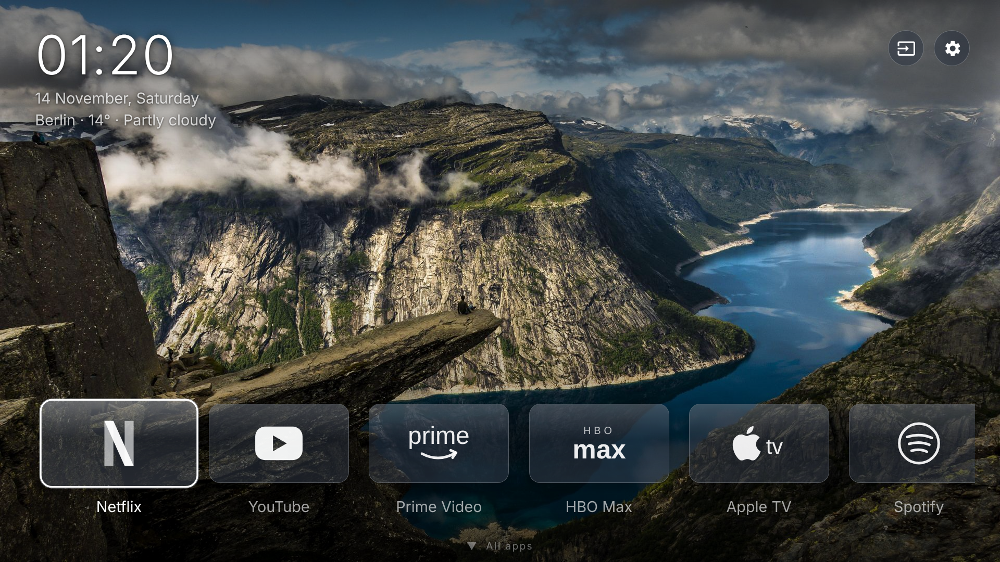
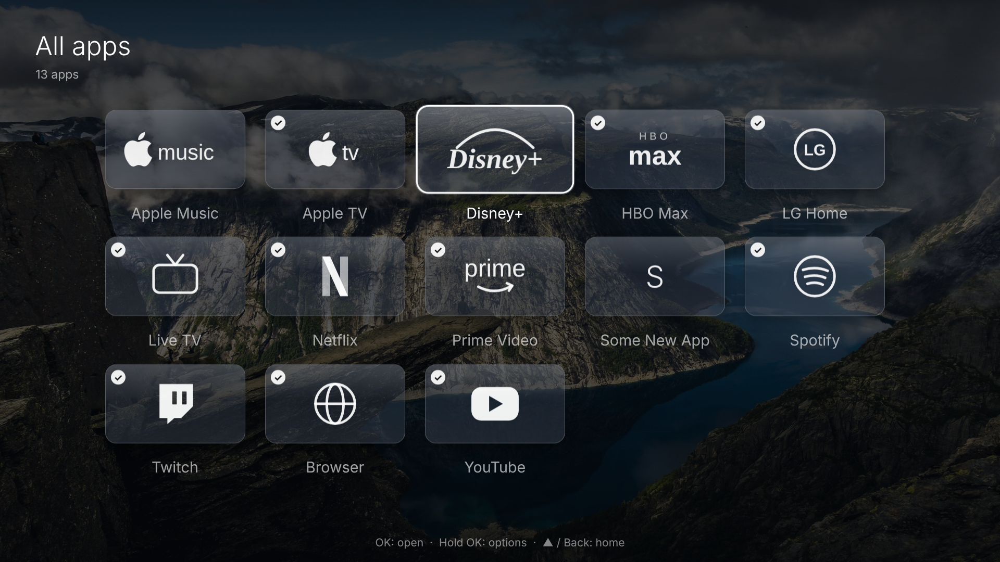
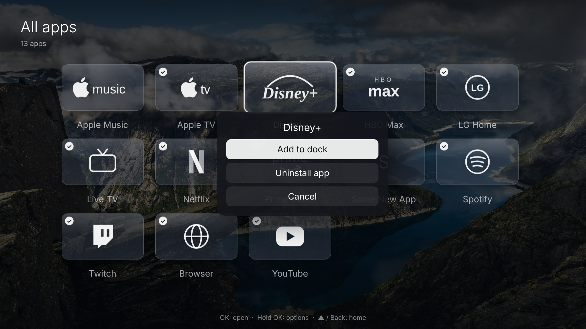
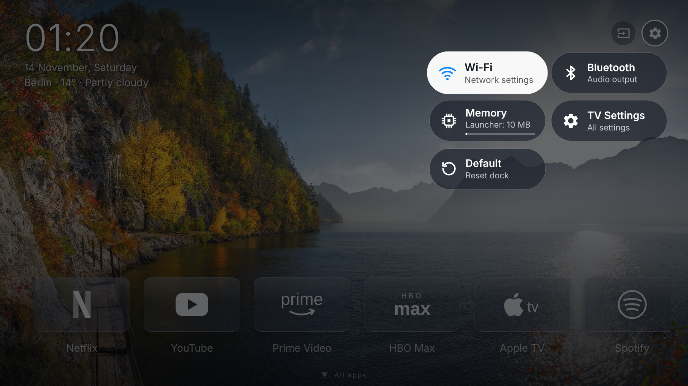

# webos_launcher

A clean, Apple TV–style home screen for **LG webOS TVs**, installed through Developer Mode.
Built with plain ES5 JavaScript (no frameworks), so it runs on old and new webOS versions.
Developed and tested on an LG OLED55A16LA (webOS 6.x).



## Features

- **Apple TV–style dock** with large glass tiles and minimal white logos
- **All apps grid** – press **▼** on the dock and the screen slides down to show *every* app installed on the TV, so you never have to go back to the LG home screen. New apps get a **New** badge automatically
- **Hold OK on any app** in the grid for a menu: add to / remove from the dock, or try to uninstall
- **Reorder the dock** – hold OK on a tile, then move it with ◀ ▶
- **Remove apps from the dock** and bring everything back with the **Default** card
- **Input picker** (HDMI 1–4) and a **control panel** (Wi-Fi, Bluetooth, memory, TV settings)
- **Clock, date and weather** – the city is detected automatically
- **Wallpaper slideshow** with a soft crossfade (add your own images)
- Unknown / new apps show their first letter instead of a mismatched logo, so the theme stays consistent
- Everything is stored on the TV (`localStorage`); no account, no tracking

| All apps | Hold OK menu | Control panel |
|---|---|---|
|  |  |  |

## Requirements

- An LG webOS TV with **Developer Mode** enabled ([guide](https://webostv.developer.lge.com/develop/getting-started/developer-mode-app))
- [`@webos-tools/cli`](https://www.npmjs.com/package/@webos-tools/cli) (`npm install -g @webos-tools/cli`) and your TV added as a device:
  `ares-setup-device`

## Install

```bash
# build the package (the launcher app + its small helper service)
ares-package com.custom.launcher com.custom.launcher.service -o out

# install and start it on your TV (replace "tv" with your device name)
ares-install -d tv out/com.custom.launcher_*_all.ipk
ares-launch  -d tv com.custom.launcher
```

To use it as your home screen you can launch it from the LG app list; replacing the physical
Home button behaviour is not part of this project.

## Controls

| Where | Key | Action |
|---|---|---|
| Dock | ◀ ▶ | Move focus |
| Dock | OK | Open app |
| Dock | Hold OK | Edit mode (◀ ▶ move, ▼ remove, OK/Back finish) |
| Dock | ▼ | Open the **All apps** grid |
| Dock | ▲ | Top buttons (input, control panel) |
| All apps | OK | Open app |
| All apps | Hold OK | Menu: add/remove from dock, uninstall |
| All apps | ▲ / Back | Back to the home screen |

## Configuration

Everything is in [`com.custom.launcher/config.js`](com.custom.launcher/config.js):

- `apps` – the default dock (`id` is the webOS app id, `icon` an SVG in `logos/`)
- `known` – apps that get a logo in the grid but are not in the default dock
- `inputs` – HDMI inputs shown in the picker
- `wallpapers` / `wallpaperEvery` – your own images (put them in `wallpapers/`) and the interval in seconds
- `weather` – `auto: true` detects the city from your IP; set `auto: false` and a `name`, `lat`, `lon` to pin a city
- `orderVersion` – increase it to reset every saved dock order
- `allApps` – built-in fallback list for the grid (see below)

You can find the id of any app with `ares-launch -d tv <id>`; common ones are `netflix`,
`youtube.leanback.v4`, `amazon`, `spotify-beehive`, `com.webos.app.browser`, `com.webos.app.livetv`.

## How the app list works (and its limits)

LG offers no official API for third-party apps to list installed apps, so the grid tries four
sources in order:

1. the `luna://com.webos.applicationManager/listLaunchPoints` service call
2. the launcher's helper service (`com.custom.launcher.service`)
3. **SSAP**, the TV's remote-control protocol on `ws://127.0.0.1:3000`. The **first time**, the TV shows a
   permission prompt (like pairing a remote app) – choose **Yes / Approve**. The key is stored afterwards
4. the built-in `allApps` list in `config.js`

If your TV refuses 1–3 the grid still works with the built-in list; the status line under the title
tells you which source was used. On some TVs 127.0.0.1 does not work – add your TV's IP to `ssapHosts`.

## Known limitations

- **"Uninstall app" does not work on a normal (non-rooted) TV.** webOS does not allow
  third-party apps to remove other apps, so you will see *Could not uninstall*. The entry is kept for rooted
  TVs (untested). Removing an app from the **dock** always works; to really uninstall use the LG home screen.
- System apps cannot be uninstalled.
- The grid and SSAP behaviour were verified on webOS 6.x only; other versions may differ.
- The location is derived from your IP address and can be wrong (it may show your provider's city).

## Privacy

The launcher makes these requests, and nothing else:

- `ipwho.is` – approximate city for the weather (only if `weather.auto` is `true`; cached for a day)
- `api.open-meteo.com` (fallback `wttr.in`) – current weather for that city

No analytics. Set `weather: null` in `config.js` to disable weather and location entirely.

## Project structure

```
com.custom.launcher/          the web app (index.html, app.js, style.css, config.js, logos/)
com.custom.launcher.service/  small JS service (memory info, app list fallback)
docs/                        screenshots
```

The code is intentionally dependency-free and uses `vw` units and ES5 so it also runs on old
Chromium versions found on older webOS TVs.

## License

MIT – see [LICENSE](LICENSE). Third-party notices: [NOTICE.md](NOTICE.md).
Logos only refer to the respective services; all trademarks belong to their owners.
